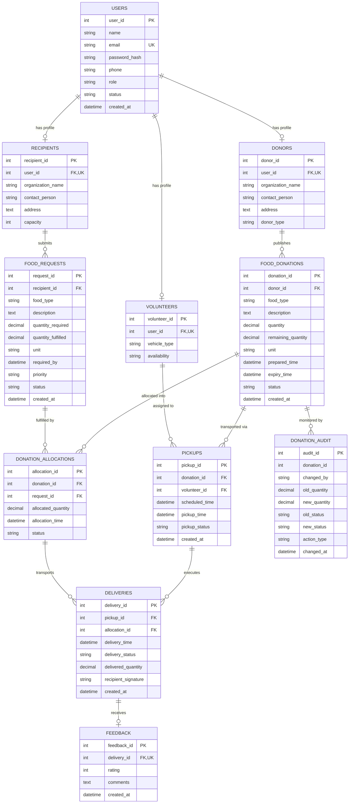

# Entity-Relationship (ER) Design & Relational Schema (Phase 2)
## Smart Food Rescue & Redistribution Intelligence System

### 1. Conceptual & Logical ER Modeling

The schema resolves the core domain entities and their cardinalities:

```
[ users ] 1 --------- 1 [ donors ]
    |
    | 1 --------------- 1 [ recipients ]
    |
    | 1 --------------- 1 [ volunteers ]

[ donors ] 1 --------- N [ food_donations ]
[ recipients ] 1 ----- N [ food_requests ]

[ food_donations ] 1 --+
                       |-- M:N resolved by --> [ donation_allocations ]
[ food_requests ]  1 --+                                |
                                                        |
[ food_donations ] 1 --------- N [ pickups ] <---------+
                                    | 1
                                    |
[ donation_allocations ] 1 --- N [ deliveries ]
                                    | 1
                                    |
                                1 [ feedback ]

[ food_donations ] 1 --------- N [ donation_audit ] (Trigger-generated)
```

#### Detailed Entity Cardinality Matrix
| Relationship | Multiplicity | Physical Realization | Business Rule Justification |
| :--- | :--- | :--- | :--- |
| `users` to `donors` | 1 : 0..1 | `donors.user_id` UNIQUE FK | A user in role `DONOR` owns exactly one donor profile. |
| `users` to `recipients` | 1 : 0..1 | `recipients.user_id` UNIQUE FK | A user in role `RECIPIENT` owns exactly one NGO profile. |
| `users` to `volunteers` | 1 : 0..1 | `volunteers.user_id` UNIQUE FK | A user in role `VOLUNTEER` owns exactly one volunteer profile. |
| `donors` to `food_donations` | 1 : N | `food_donations.donor_id` FK | A donor can log multiple food surplus donations over time. |
| `recipients` to `food_requests` | 1 : N | `food_requests.recipient_id` FK | A recipient NGO posts multiple ongoing or emergency requisitions. |
| `food_donations` to `food_requests` | M : N | `donation_allocations` associative table | A large donation can satisfy multiple smaller requests; conversely, a large request can receive portions from multiple donations. |
| `food_donations` to `pickups` | 1 : N | `pickups.donation_id` FK | A donation can be picked up in full or across multi-vehicle dispatches. |
| `volunteers` to `pickups` | 1 : N | `pickups.volunteer_id` FK | A volunteer undertakes multiple scheduled pickup dispatches. |
| `pickups` & `allocations` to `deliveries`| 1:N & 1:N | `deliveries.(pickup_id, allocation_id)` | Each delivery leg corresponds to an allocated quantity carried under a pickup assignment. |
| `deliveries` to `feedback` | 1 : 0..1 | `feedback.delivery_id` UNIQUE FK | Each completed delivery accepts exactly one verified post-dropoff review. |
| `food_donations` to `donation_audit` | 1 : N | `donation_audit.donation_id` | Historical log of every status and quantity delta enforced by MySQL triggers. |

---

### 2. Mermaid ER Diagram Specification



---

### 3. Relational Schema in Formal DBMS Notation

Underlined attributes indicate **Primary Keys [PK]**.
Dashed or marked attributes indicate **Foreign Keys [FK]**.

1. **users** (
   <u>user_id</u>,
   name,
   email [UNIQUE],
   password_hash,
   phone,
   role,
   status,
   created_at
)

2. **donors** (
   <u>donor_id</u>,
   user_id [FK -> users.user_id, UNIQUE],
   organization_name,
   contact_person,
   address,
   donor_type
)

3. **recipients** (
   <u>recipient_id</u>,
   user_id [FK -> users.user_id, UNIQUE],
   organization_name,
   contact_person,
   address,
   capacity
)

4. **volunteers** (
   <u>volunteer_id</u>,
   user_id [FK -> users.user_id, UNIQUE],
   vehicle_type,
   availability
)

5. **food_donations** (
   <u>donation_id</u>,
   donor_id [FK -> donors.donor_id],
   food_type,
   description,
   quantity,
   remaining_quantity,
   unit,
   prepared_time,
   expiry_time,
   status,
   created_at
)

6. **food_requests** (
   <u>request_id</u>,
   recipient_id [FK -> recipients.recipient_id],
   food_type,
   description,
   quantity_required,
   quantity_fulfilled,
   unit,
   required_by,
   priority,
   status,
   created_at
)

7. **donation_allocations** (
   <u>allocation_id</u>,
   donation_id [FK -> food_donations.donation_id],
   request_id [FK -> food_requests.request_id],
   allocated_quantity,
   allocation_time,
   status
)

8. **pickups** (
   <u>pickup_id</u>,
   donation_id [FK -> food_donations.donation_id],
   volunteer_id [FK -> volunteers.volunteer_id],
   scheduled_time,
   pickup_time,
   pickup_status,
   created_at
)

9. **deliveries** (
   <u>delivery_id</u>,
   pickup_id [FK -> pickups.pickup_id],
   allocation_id [FK -> donation_allocations.allocation_id],
   delivery_time,
   delivery_status,
   delivered_quantity,
   recipient_signature,
   created_at
)

10. **feedback** (
    <u>feedback_id</u>,
    delivery_id [FK -> deliveries.delivery_id, UNIQUE],
    rating,
    comments,
    created_at
)

11. **donation_audit** (
    <u>audit_id</u>,
    donation_id,
    changed_by,
    old_quantity,
    new_quantity,
    old_status,
    new_status,
    action_type,
    changed_at
)

12. **outbox_events** (
    <u>event_id</u>,
    aggregate_type,
    aggregate_id,
    event_type,
    payload,
    status,
    created_at,
    processed_at
)
